<!-- کارت اسم: اسم یوزرنیم گیت‌هابت با افکت تایپ، عکسش ثابته (logo.jpg) -->

  

<h1 align="center">سلام 👋</h1>

  یه بخش درباره‌ی خودت اینجا بنویس: چی کار می‌کنی، روی چی کار می‌کنی، به چی علاقه داری.

---

<!-- بخش انیمیشن: هواپیما از چپ به راست می‌ره و روزهای فعالیتت رو می‌زنه -->

  

<!-- بخش زبان‌ها: درصد زبان‌های ریپوهات، هر ۶ ساعت خودکار آپدیت می‌شه -->

  

<!-- بخش پروژه‌ها: ریپوهای pin‌شده‌ت به ترتیب تاریخ ساخت، خودکار آپدیت می‌شه -->

  

---

<!--
  بعد از اینکه ریپوی پروفایلت (همنام با یوزرنیمت) رو ساختی،
  می‌تونی بخش‌های دیگه مثل اسکیل‌ها و لینک‌ها رو هم اینجا اضافه کنی.
-->
