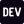

<!-- کارت اسم: اسم ثابته و کد مورس (NIGHTMARE) با افکت تایپ حرکت می‌کنه -->

  

<!-- آیکون‌های شبکه‌های اجتماعی: هم‌اندازه و هم‌رنگ با متن. لینک‌های YOUR_... رو با آدرس خودت عوض کن -->

  
  &nbsp;&nbsp;&nbsp;
  
  &nbsp;&nbsp;&nbsp;
  
  &nbsp;&nbsp;&nbsp;
  

<!-- بخش انیمیشن: هواپیما از چپ به راست می‌ره و روزهای فعالیتت رو می‌زنه -->

  

<!-- بخش زبان‌ها: درصد زبان‌های ریپوهات، هر ۶ ساعت خودکار آپدیت می‌شه -->

  

<!-- بخش پروژه‌ها: ریپوهای pin‌شده‌ت به ترتیب تاریخ ساخت، خودکار آپدیت می‌شه -->

  

---

<!--
  بعد از اینکه ریپوی پروفایلت (همنام با یوزرنیمت) رو ساختی،
  می‌تونی بخش‌های دیگه مثل اسکیل‌ها و لینک‌ها رو هم اینجا اضافه کنی.
-->
